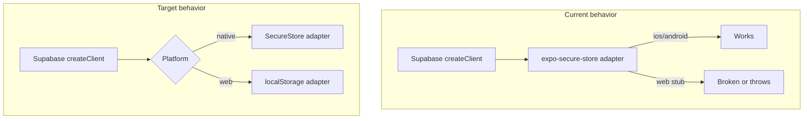

# Plan: Fix Expo / Metro / Web development errors

**Project:** Smoke Ledger India (Expo SDK 51, Expo Router, Supabase)  
**Scope:** Local development and web preview reliability—not a full production web hardening unless you extend scope later.  
**How to use this document:** Work **top to bottom** in iterations. Each iteration has **goals**, **steps**, **expected results**, **if something goes wrong**, and a **checkpoint** before moving on.

---

## 1. Context and baseline

### 1.1 What “errors” means here

Static analysis is already clean:

| Check            | Typical command   | Expected today                          |
| ---------------- | ----------------- | --------------------------------------- |
| TypeScript       | `npm run typecheck` | Passes (`tsc --noEmit`)               |
| ESLint           | `npm run lint`      | Passes                                 |

The failures you hit when **running** the app fall into three **separate** buckets (fixing one does not fix the others):

1. **Expo / React Native version drift** — Metro prints warnings that installed packages are **older** than the versions Expo SDK 51 expects. The app may still run; warnings are a **compatibility risk**, not always a hard crash.
2. **Metro port + non-interactive CLI** — If port **8081** is taken, Expo asks *interactively* whether to use another port. In **non-interactive** environments (some terminals, CI, automation), Expo **skips starting** the dev server instead of choosing a port for you.
3. **Web runtime: Supabase auth storage** — [`src/lib/supabase.ts`](../../src/lib/supabase.ts) registers Supabase `auth.storage` using **`expo-secure-store`** for all platforms. On **web**, the native module is a **stub** (`ExpoSecureStore.web.js` exports an empty object), so persistence APIs are effectively **missing**. The **bundle can succeed** while **login/session still breaks** at runtime in the browser.

### 1.2 Architecture snapshot (before vs after)



### 1.3 Files you will touch

| File / area | Why |
| ----------- | --- |
| [`package.json`](../../package.json) | Dependency versions; optional `scripts` for fixed Metro port |
| [`src/lib/supabase.ts`](../../src/lib/supabase.ts) | Platform-specific auth `storage` for Supabase |
| Lockfile (`package-lock.json` if npm) | Updated automatically when dependencies change |

### 1.4 Out of scope (unless you explicitly expand)

- Large **`npm audit fix --force`** campaigns (often destabilizes React Native / Expo).
- Production-grade **web security** (CSP, httpOnly cookies, BFF for tokens)—only noted as follow-ups where relevant.

---

## 2. Iteration 0 — Preconditions and hygiene

**Goal:** Same starting line every time; avoid false negatives from stale installs.

**Steps (in order):**

1. From the repository root ([`SmokeCalc`](../../)), confirm Node **18+** (per README).
2. Ensure you are on the branch you intend to change; note current `git status` (optional but recommended).
3. If you recently cloned or switched branches, run **`npm install`** once so `node_modules` matches [`package.json`](../../package.json).

**Checkpoint:**

- [ ] `npm run typecheck` completes with **exit code 0**.
- [ ] `npm run lint` completes with **exit code 0**.

**If something goes wrong:**

- On Windows under OneDrive, if installs fail with `EPERM` or postinstall issues, see troubleshooting in [`README.md`](../../README.md) (`--ignore-scripts` path, etc.).

---

## 3. Iteration 1 — Align native dependencies with Expo SDK 51

**Goal:** Remove Metro’s “expected version” warnings by bringing **`react-native`**, **`react-native-safe-area-context`**, and **`react-native-screens`** in line with what Expo SDK 51 expects (e.g. patch bumps like `0.74.0` → `0.74.5` were called out in dev logs).

**Why this iteration exists:** Expo’s supported matrix is tested as a **set**. Drifted patch versions can cause subtle navigation / gesture / native screen bugs that are expensive to debug later.

**Steps (recommended path):**

1. In the project root, run:

   ```bash
   npx expo install --fix
   ```

   This asks Expo to reconcile versions against the installed SDK.

2. **Alternative (minimal explicit pins):** If you prefer not to run broad `--fix`, install only what Metro complained about, for example:

   ```bash
   npx expo install react-native@0.74.5 react-native-safe-area-context@4.10.5 react-native-screens@3.31.1
   ```

   Adjust exact versions if `expo install` suggests different pins for your minor SDK revision.

3. Start Metro once (any platform) and **read the first screen of logs**:

   ```bash
   npx expo start
   ```

4. Optionally run:

   ```bash
   npx expo-doctor
   ```

   Address only items that clearly relate to this project (do not chase every optional advisory in one pass).

**Expected results:**

- Metro **no longer** prints the yellow “following packages should be updated…” block for the packages you aligned—or the list is strictly shorter / resolved.
- App still launches on at least **one** target you care about (Expo Go, Android emulator, or iOS simulator).

**If something goes wrong:**

- **Install errors:** Clear `node_modules` and reinstall (last resort on Windows: close editors holding files, run shell as user with folder rights).
- **New native crash after bump:** Note the **first** stack trace; often it is a **single** incompatible transitive dependency—re-run `npx expo install --fix` once more before debugging app code.
- **Rollback:** Revert [`package.json`](../../package.json) and lockfile via git; reinstall.

**Checkpoint:**

- [ ] Dependency versions updated and lockfile committed (when you are ready to commit).
- [ ] `npm run typecheck` still **0 errors**.
- [ ] `npm run lint` still **0 errors** (or only pre-existing warnings you accept).

---

## 4. Iteration 2 — Stable Metro / web dev entry (non-interactive safe)

**Goal:** Starting the dev server never depends on answering **“use another port?”** in a terminal that cannot prompt.

**Why this iteration exists:** Default Metro **8081** is shared by other tools, other Expo projects, and sometimes zombie processes. Non-interactive mode **exits without starting**, which looks like “nothing happened.”

**Steps:**

1. Choose a **fallback port** you will standardize on for this repo (example: **8083**). Avoid clashing with other fixed services on your machine.
2. Update [`package.json`](../../package.json) `scripts`, for example:

   - **`web`:** `expo start --web --port <chosen>`  
   - Optionally **`start`:** `expo start --port <chosen>` if you want **all** platforms to share the same Metro port policy.

3. On **PowerShell**, remember chained commands must use **`;`** not `&&` on older Windows builds:

   ```powershell
   Set-Location <repoRoot>; npm run web
   ```

4. If a port is still “in use” after stopping Expo:

   - Close other Metro/Expo windows, or  
   - Pick a different fixed port in the script, or  
   - Identify and stop the process holding the port (OS-specific).

**Expected results:**

- Running `npm run web` (or your updated script) **always** prints `Waiting on http://localhost:<chosen>` without prompting.
- Browser loads the dev URL without “dev server skipped” behavior.

**Tradeoffs (explicit):**

- **Fixed port:** Two clones of the same repo running **simultaneously** on one machine may conflict—acceptable for solo dev; use a second port only if needed.

**Checkpoint:**

- [ ] `npm run web` starts Metro **without** interactive port questions.
- [ ] You can reload the web app and Metro stays up.

---

## 5. Iteration 3 — Web-safe Supabase session storage

**Goal:** Supabase `auth.storage` works on **web** (session persist + refresh) while keeping **SecureStore** on **iOS/Android**.

**Why this iteration exists:** [`src/lib/supabase.ts`](../../src/lib/supabase.ts) currently uses `expo-secure-store` for `getItem` / `setItem` / `removeItem`. On web, that module is not a real secure store implementation; Supabase auth calls will not behave like native.

**Design rules:**

| Platform | Storage backend | Rationale |
| -------- | ---------------- | --------- |
| `ios`, `android` | `expo-secure-store` (current adapter) | Hardware-backed where available; matches product privacy stance for mobile. |
| `web` | `localStorage` (small adapter) | Works in browsers; same-origin XSS is the main threat—acceptable for **dev / preview**; document limitation if you ship web. |

**Steps (implementation outline):**

1. In [`src/lib/supabase.ts`](../../src/lib/supabase.ts), import `Platform` from `react-native` (already a project dependency).
2. Build **two** adapters behind a single factory or conditional:

   - **Native adapter:** keep existing `SecureStore.getItemAsync` / `setItemAsync` / `deleteItemAsync` mapped to Supabase’s `getItem` / `setItem` / `removeItem` (Supabase accepts sync or async shapes per version—match your installed `@supabase/supabase-js` typings).
   - **Web adapter:** wrap `window.localStorage`:

     - `getItem(key)` → read string or `null`
     - `setItem(key, value)` → write string
     - `removeItem(key)` → delete key  
     Guard `typeof window !== 'undefined'` if any import path could run SSR (Expo web is usually client-only for this file, but defensive checks are cheap).

3. Pass the chosen adapter into `createClient(..., { auth: { storage: ... } })` **once** when constructing the singleton.

4. **`detectSessionInUrl`:** leave **`false`** on native as today. For **web**, only set **`true`** if you use **magic links / OAuth redirects** that rely on URL fragments or query params; otherwise keep `false` to avoid surprising behavior. Treat this as a **sub-step** you enable only when a concrete auth flow requires it.

**Expected results:**

- Web: sign in, **refresh** the page, user remains authenticated (or session refresh runs without SecureStore-related exceptions).
- Native: behavior unchanged vs current SecureStore path.

**Security note (do not skip):**

- `localStorage` is **not** equivalent to SecureStore. For **production web**, plan separately: CSP, token lifetimes, and possibly a server-side session strategy.

**If something goes wrong:**

- **“Cannot read property localStorage of undefined”:** ensure code runs only in browser bundle paths; add guards.
- **Session still lost on web:** confirm the **same** `storageKey` is used as before and that multiple tabs are not fighting with different keys (rare; document if you change keys).

**Checkpoint:**

- [ ] Web login + refresh works without console errors from storage.
- [ ] Native login still works on device or simulator.

---

## 6. Iteration 4 — Verification matrix (sign-off)

Run this matrix **after** Iterations 1–3 (or after whichever subset you implemented).

| Step | Command / action | Pass criteria |
| ---- | ---------------- | ------------- |
| 1 | `npm run typecheck` | Exit 0 |
| 2 | `npm run lint` | Exit 0 |
| 3 | `npm run web` | Metro starts on configured port; **Web Bundled** appears; app loads |
| 4 | Web manual | Sign in → hard refresh → still signed in (or clear re-auth if you intentionally disabled persist) |
| 5 | Native manual | Sign in → background app → return; session still valid (best-effort) |
| 6 | Optional | `npx expo-doctor` | No unresolved **blocking** items |

**Definition of done (minimum):**

- [ ] No interactive port prompt required for your standard `npm run web` / `npm run start` workflow.
- [ ] No SecureStore-backed Supabase storage on **web**.
- [ ] Expo version warnings for the aligned packages are **resolved or explicitly accepted** with a written reason in your PR/commit message.

---

## 7. Optional follow-ups (post–sign-off)

1. **Contributor docs:** Add a short “Web dev” section to [`README.md`](../../README.md) (port choice, `localStorage` caveat)—only when you want others to reproduce web preview quickly.
2. **`npm audit`:** Triage **high** items individually; avoid blanket `--force` on Expo projects without a rollback branch.
3. **Production web:** If web becomes a first-class distribution channel, open a **new** plan: auth cookie strategy, CSP, and threat model for tokens in the browser.

---

## 8. Traceability

| Symptom | Likely iteration | Primary fix |
| ------- | ----------------- | ----------- |
| Yellow Metro “expected version” text | Iteration 1 | `expo install --fix` or targeted pins |
| “Skipping dev server” / no URL | Iteration 2 | Explicit `--port` in scripts; free the port |
| Web bundle OK but auth broken / SecureStore errors | Iteration 3 | Platform-specific Supabase `auth.storage` |
| `tsc` / `eslint` failures | Outside this plan | Fix types/lint as separate tasks (baseline was clean) |

---

## 9. Changelog of this plan document

| Version | Date | Notes |
| ------- | ---- | ----- |
| 1.0 | 2026-05-04 | Initial detailed iterative plan authored from SmokeCalc / Expo dev findings |
